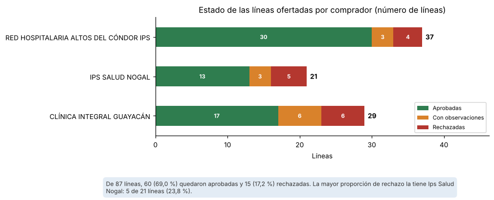

# Validación de precios de medicamentos y gestión de PQR en licitaciones y convenios

[](https://colab.research.google.com/github/ivanherrerabaquero-dev/validacion-precios-medicamentos/blob/main/notebooks/proyecto_validacion_precios.ipynb)
[](https://ivanherrerabaquero-dev.github.io/validacion-precios-medicamentos/)

Proyecto de portafolio que simula el trabajo del área de **PQR y apoyo a licitaciones y convenios** de **CRM TECNOLOGÍAS EN SALUD**, un gestor farmacéutico ficticio (distribuidor mayorista y dispensador de medicamentos).

> ℹ️ **Datos:** los **precios máximos, CUM y medicamentos son reales**: provienen de la tabla pública de *Precios máximos de venta por presentación comercial* de la Circular 022 de 2026 de la Comisión Nacional de Precios de Medicamentos y Dispositivos Médicos (38.999 presentaciones). La empresa **CRM TECNOLOGÍAS EN SALUD**, los compradores, NIT, tarifas ofertadas, cantidades, precios piso y PQR son **ficticios**.

## El problema

Los compradores institucionales (grande, mediano y pequeño) envían sus bases de medicamentos en Excel con los precios propuestos para cada convenio o licitación. Cada archivo llega con un formato distinto y con errores. Antes de legalizar el acuerdo hay que:

1. **Consolidar** todas las bases en una sola.
2. **Validar** que ningún precio supere el **precio máximo de venta (PMV)** regulado y que no quede por debajo del precio piso interno.
3. **Recibir y hacer seguimiento a las PQR** de usuarios internos (equipos de licitaciones y convenios) y de compradores, dentro del término legal.
4. Entregar **informes ejecutivos** y **documentos gerenciales**.

## Novedades

- **Listas sin precio (consulta de referencias):** si el archivo solo trae CUM y nombre, la página de análisis y el asistente de IA informan para cada CUM si está regulado (Circular 022), su precio SISMED por presentación o, si no existe, el precio 2024 por unidad de su expediente (Termómetro de Precios). Marca los medicamentos de control especial (MCE).
- **Tabla oficial de precios máximos actualizada:** 39.458 registros (datos.gov.co, 17/11/2026), incluidos los de circulares anteriores aún vigentes.
- **Asistente de IA (Paso 10):** lee documentos sin formato (Excel con títulos raros, PDF de circulares, Word) que se dejan en la carpeta `ia` del Drive; detecta CUM, tarifas, precios máximos, códigos MAPIPOS/CUPS y topes regulatorios, y cruza cada CUM con la Circular 022 y el SISMED. Usa la IA de Colab, Gemini (`GOOGLE_API_KEY`) o Claude (`ANTHROPIC_API_KEY`); sin llave, lee por contenido.
- **Gráficos más claros:** los conteos muestran solo el número; las proporciones y el cumplimiento, solo el %. La nota de cada gráfico explica qué representa cada cifra.
- **Lectura por contenido en el portal:** la página de análisis reconoce el CUM, el precio y la cantidad por la forma de los datos aunque los encabezados no se parezcan.
- **SISMED para medicamentos no regulados:** si un CUM no está en la Circular 022, se compara con el precio de venta publicado en el SISMED. A crédito de 90 días el margen viable es de 22 % a 32 %; de contado, ±5 %. Por encima se marca **riesgo de especulación** (posible reporte ante la SIC). La forma de pago se lee del encabezado de cada oferta. Precio de referencia: 2024 del Termómetro de Precios de Clicsalud (Ministerio de Salud, con reportes al SISMED) y, si no existe, 2019 de la consulta pública del SISMED.
- **Analizar un archivo (con usuario y contraseña):** página `analizar.html` del portal donde se sube una oferta o una base de PQRS y se recibe el análisis con gráficos, notas y descarga en Excel. El archivo se procesa en el navegador; el acceso es una protección básica de un sitio estático.
- **PQRS separadas:** pestañas distintas para **PQRS B2B comercial** y **PQRS dispensación**, además de una vista de gestión conjunta.
- **Gráficos con número, % y nota:** cada gráfico del portal, del informe HTML y del memorando muestra el valor y el porcentaje, con una nota que explica las cifras.
- **Sin datos aleatorios:** el notebook solo lee los Excel de Drive (ofertas de los 3 compradores, base de PQRS y catálogo con precio piso). Si cambias un valor y vuelves a ejecutar, cambian los resultados.
- **Cruce con la Circular 022:** por cada línea muestra tarifa ofertada, PMV de la Circular 022, % de ganancia sobre el PMV, precio piso (costo), % de margen y % de pérdida cuando la tarifa queda bajo el costo (hoja `CRUCE_CIRCULAR_022`).
- **Lectura inteligente:** reconoce columnas aunque cambien de nombre (`Código CUM`, `Valor unitario ofertado`, `cum/ium`, `precio`…), busca el encabezado en cualquier hoja y fila, y lee cualquier archivo `.xlsx`, `.xls`, `.xlsb` o `.csv` sin importar su nombre. Deja un reporte de lectura.
- **Compradores ficticios con nombre:** Red Hospitalaria Altos del Cóndor IPS (grande), Clínica Integral Guayacán (mediano) e IPS Salud Nogal (pequeño), cada uno con un formato de archivo distinto.
- **440 PQRS dinámicas** en dos canales (B2B y dispensación), con estacionalidad, severidad, acuerdo de servicio, reincidencia, tutelas, escalamiento a ente, satisfacción e impacto económico.
- **Metas regulatorias** (SIC, Supersalud, INVIMA e internas) con semáforo.
- **Casos reales del mercado anonimizados**, con fuente, relacionados con las categorías de PQRS.
- **Dashboard con pestañas y filtros cruzados** (comprador, canal, ciudad, categoría, severidad, estado, mes) y gráficos que filtran al hacer clic.

## Funciones del cargo que cubre

| Función | Entregable |
|---|---|
| Consolidación de datos | Paso 3 del notebook |
| Generación de informes ejecutivos | Excel con formato, informe ejecutivo HTML y portal web |
| Recepción de PQR | Paso 5: base de PQR con días hábiles y oportunidad |
| Generación de documentos gerenciales | Memorando en Word generado automáticamente |
| Atención a usuarios internos de licitaciones y convenios | Segmentación de PQR por solicitante |

## Cómo funciona

```
data/entrada/*.xlsx  ──►  Notebook (Colab)  ──►  data/salida/consolidado_validacion.xlsx
 (3 compradores)          · lectura robusta       reportes/memorando_gerencial.docx
data/referencia/          · validación PMV        docs/data/*.json  ──►  Portal web (GitHub Pages)
 (PMV + catálogo)         · PQR y KPIs
```

**Regla clave de validación:** la Circular 022 de 2026 publica el PMV **por presentación comercial (CUM)** para tres tipos de transacción. Como las licitaciones y convenios son ventas a compradores institucionales, cada línea se cruza por CUM y se compara con el **PMV institucional**:

```
Tarifa ofertada por presentación  >  PMV institucional del CUM   →  línea rechazada
Ej.: IRBESARTÁN 150 mg x 25 tabletas: tarifa $20.143 vs PMV $17.250  →  +16,8 %
```

### Validaciones por línea

- CUM con formato válido (expediente-consecutivo o IUM) y presente en la tabla de la Circular 022.
- Líneas duplicadas.
- Tarifa, IVA y cantidad diligenciados correctamente.
- Tarifa **superior al PMV** → la línea se rechaza (riesgo de sanción).
- Tarifa **inferior al precio piso** interno → riesgo de margen.

### PQR

- Días hábiles calculados con fines de semana y festivos de Colombia 2026.
- Término de respuesta: 15 días hábiles (Ley 1755 de 2015).
- Indicadores: oportunidad, tiempo promedio, abiertas fuera de término, motivos y tipo de solicitante.

## Resultados (corte 20/11/2026)

| Indicador | Valor |
|---|---|
| Líneas validadas | 87 |
| Aprobadas sin observaciones | 66,7 % |
| Líneas sobre el PMV | 6 |
| Líneas no reguladas con riesgo de especulación (SISMED) | 3 |
| Excedente sobre PMV o tope SISMED | $25,6 millones/mes |
| Líneas con pérdida (bajo el costo) | 5 · $12,4 millones/mes |
| Margen promedio de las ofertas | 13,7 % |
| PQRS recibidas | 440 |
| Oportunidad legal (≤ 15 días hábiles) | 95,3 % |
| Cumplimiento del acuerdo de servicio | 74,6 % |
| Metas regulatorias en rojo | 3 de 6 |



## Estructura

```
├── notebooks/proyecto_validacion_precios.ipynb   Notebook paso a paso (Colab)
├── data/
│   ├── entrada/       Bases de los compradores (Excel simulados)
│   ├── referencia/    Tabla oficial de PMV (Circular 022 de 2026, CSV) y catálogo de la empresa
│   └── salida/        Consolidado validado en Excel e informe ejecutivo HTML
├── reportes/          Memorando gerencial (Word) y gráficos
└── docs/              Portal web (GitHub Pages), informe_ejecutivo.html, datos JSON y descargas
```

## Cómo ejecutarlo

1. Sube a tu Drive, carpeta `TECNOLOGIAS EN SALUD/entrada`, las 3 ofertas y `base_pqrs_2026.xlsx`; y a `referencia`, la tabla de la Circular 022, `catalogo_empresa.xlsx` y `sismed_precios_institucionales.xlsx` (están en `data/` de este repositorio).
2. Abre el notebook con el botón **Abrir en Colab**.
3. Ejecuta las celdas en orden (*Entorno de ejecución → Ejecutar todas*).
4. Opcional: cuando la Comisión publique una nueva versión de la tabla, súbela como `data/referencia/circular_oficial_nueva.xlsb` y ejecuta el Paso 2B.
5. Opcional: activa `PUBLICAR = True` en el Paso 9 para subir los resultados y actualizar el portal.

## Herramientas

Python · pandas · NumPy · openpyxl · python-docx · Matplotlib · HTML/JavaScript · Chart.js · GitHub Pages · Google Colab

## Marco normativo de referencia

- Circular 022 de 2026, Comisión Nacional de Precios de Medicamentos y Dispositivos Médicos: precios máximos de venta por presentación comercial, vigentes desde el 19 de agosto de 2026.
- Ley 1755 de 2015 (derecho de petición y términos de respuesta).
- SISMED, Ministerio de Salud: consulta pública de precios de medicamentos (datos.gov.co, 3he6-m866) y Termómetro de Precios de Clicsalud 2024 (n4dj-8r7k).
- Ley 1480 de 2011 (Estatuto del Consumidor) y vigilancia de la SIC sobre precios.

## Autor

**Ivan Santiago Herrera Baquero** · Administrador de Empresas · Gestión de PQRS y análisis de datos en salud
[LinkedIn](https://www.linkedin.com/in/ivan-santiago-herrera-baquero-523385204/) · [GitHub](https://github.com/ivanherrerabaquero-dev)
